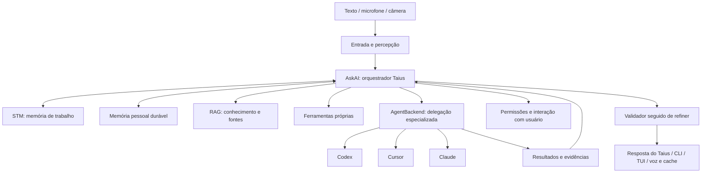

# Plano de evolução do AskAI: Taius como Jarvis pessoal

Status: em implementação. O primeiro incremento está descrito abaixo; as demais etapas continuam como plano.

## Primeiro incremento implementado

- Orquestrador independente de view, com toda pergunta encaminhada ao Codex CLI App Server.
- Splitter e executor próprio de function calling retirados do fluxo e do código; dependências LangChain removidas de produção, testes e demos.
- STM nativa com histórico limitado e objetivo pendente; RAG com embeddings nativos e Chroma direto; validador e refiner com saída estruturada validada.
- Adaptadores de aprovação/perguntas separados para CLI e TUI; cancelamento, falhas e resposta final tipados no core.
- Codex CLI 0.162.1: handshake e turno real mínimo verificados com autenticação ChatGPT.
- Conversa real do AskAI com Ollama verificada com imports dos frameworks bloqueados; testes focados cobrem engine/voz, refiner, validador, recuperação, orquestração, transporte e diálogos.

Este incremento não conclui o roadmap. Persistência de referências de sessões dos especialistas entre reinícios, ferramentas próprias via MCP, seleção mais granular de contexto, memória durável evoluída, percepção contínua e demais agentes continuam pendentes. O modo Taius usa o Codex para todas as perguntas e a engine selecionada para componentes de qualidade; a engine OpenAI direta ainda existe para os modos existentes. A execução delegada usa o diretório de lançamento, sandbox `workspace-write` e aprovações `on-request`; concessões extras de perfis de permissão ainda são negadas explicitamente. Não há promessa de aprovação para cada comando dentro do sandbox.

## Objetivo

Evoluir o AskAI como um assistente pessoal multimodal, com identidade Taius, memória, percepção e capacidade de agir. O AskAI permanece responsável pela conversa e pela orquestração: prepara o contexto, encaminha toda pergunta ao agente e valida/refina o resultado.

O projeto foi construído por uma pessoa, com tempo e recursos limitados e tecnologias ainda emergentes. Esta evolução preserva sua intenção original e aproveita infraestrutura mais madura para ampliar suas capacidades. CLI/TUI, voz, visão, comandos, histórico e preferências fazem parte do produto, não apenas da apresentação de outro agente.

Codex, Claude e Cursor são agentes especializados disponíveis ao Taius. Cada um administra a execução da tarefa recebida dentro de um escopo delimitado. A identidade, a memória pessoal e a responsabilidade pelo objetivo do usuário pertencem ao AskAI.

“Sem API direta” significa retirar a dependência de APIs comerciais de modelos chamadas pelo AskAI, utilizando integrações oficiais de agentes e capacidades locais. Protocolos locais também são APIs. Modelos locais via Ollama continuam elegíveis para validação, refinamento e percepção; os agentes remotos continuam sujeitos à conectividade e aos limites de suas contas.

## Decisões propostas

- Manter o AskAI como orquestrador, dono dos objetivos, da conversa e da política de delegação.
- Separar contratos de raciocínio/conversa, agentes especializados, percepção, memória, ferramentas e voz. `AgentBackend` não substitui todas as responsabilidades de `AIEngine`.
- Integrar Codex pelo App Server, Cursor por ACP e Claude pelo Agent SDK Python, verificando as condições de autenticação e distribuição antes da implementação.
- Selecionar especialistas por capacidade, escopo, disponibilidade e preferência explícita; não definir especialidades fixas apenas pela marca do fornecedor.
- Usar eventos estruturados. Não interpretar telas de terminal nem filtrar palavras para descobrir respostas, raciocínio ou aprovações.
- Preservar a técnica de cache de áudio e a seleção genérica de voz, independentes do agente delegado.
- Remover o splitter e o mecanismo atual de function calling/executor de ferramentas via LLM. A decomposição e a execução internas da tarefa pertencem ao especialista; o AskAI mantém seleção, escopo e acompanhamento dos objetivos.
- Manter e evoluir STM, RAG, validador e refiner como componentes do AskAI, com contratos independentes; validação e refinamento obrigatórios após o Codex. Preservar implementações úteis, substituindo apenas acoplamentos e dependências incompatíveis com a arquitetura.
- Não alternar de provedor silenciosamente, contornar permissões ou remover componentes antes de demonstrar a cobertura de suas responsabilidades.

## Arquitetura de destino

MCP pode expor ferramentas específicas aos especialistas. O AskAI decide quais ferramentas e dados cada delegação recebe. MCP não substitui o transporte da sessão do agente nem exige que toda ferramenta local seja implementada como servidor MCP.

### Responsabilidades do orquestrador

1. Interpretar o objetivo considerando conversa, preferências e observações relevantes.
2. Encaminhar toda pergunta ao Codex neste primeiro backend. Comandos explícitos de voz, captura e memória permanecem no aplicativo; não recriar um roteador local de conversa ou um loop de function calling.
3. Definir escopo, contexto mínimo, recursos permitidos e critérios de conclusão da tarefa delegada.
4. Acompanhar progresso, perguntas, aprovações, cancelamento e resultados. A execução interna do especialista fica sob responsabilidade do runtime dele.
5. Avaliar evidências de conclusão; apresentar falhas e incertezas sem afirmar que ações não verificadas foram concluídas.
6. Responder com a identidade do Taius e atualizar somente a memória permitida.

### Percepção, memória e iniciativa

- Representar observações de áudio e imagem com origem, instante de captura e validade. Correlacionar observações relacionadas sem tratar uma imagem antiga como estado atual do ambiente.
- Separar transcrição, observação e inferência. Conteúdo ouvido, visto ou lido não recebe automaticamente autoridade para comandar ações.
- Manter controles claros para ativar, pausar e encerrar câmera e microfone, indicando quando estão ativos. O primeiro fluxo usa captura solicitada; escuta contínua e ativação por voz ficam para uma etapa posterior explicitamente configurada.
- Separar contexto temporário, histórico de tarefas e memória pessoal durável. Permitir consultar, corrigir e esquecer informações, com origem e política de retenção; não salvar mídia bruta indefinidamente por padrão.
- Enviar aos especialistas apenas o contexto necessário. Memória pessoal não depende da sessão de Codex, Claude ou Cursor.
- Introduzir iniciativa gradualmente: sugestões a partir de eventos autorizados, com limites de frequência e ações previamente permitidas. O assistente não ganha autorização irrestrita por ter câmera ou microfone.

### STM, RAG, validador e refiner

Esses componentes continuam pertencendo ao AskAI. Sua manutenção não exige preservar o encadeamento rígido do splitter antigo.

- **STM:** evoluir a memória de curto prazo existente para representar objetivo ativo, decisões, referências a observações, pendências e resultados. Definir orçamento de contexto, compactação e expiração sem perder pendências relevantes. A STM não é a sessão interna do especialista nem promove todo conteúdo à memória durável.
- **RAG:** manter recuperação de conhecimento pessoal e documentos, com proveniência, seleção e orçamento de contexto. Usá-lo antes da conversa/delegação quando o objetivo exigir esse conhecimento. Preservar índices e armazenamento úteis; migrar embeddings remotos para uma opção local quando necessário, sem descartar o componente.
- **Validador:** manter avaliação no nível do objetivo do usuário. Priorizar evidências e verificações determinísticas; usar avaliação por modelo apenas quando necessária. Distinguir aprovado, reprovado e inconclusivo. Uma declaração de sucesso do especialista não substitui evidência. Falhas não disparam reexecução automática de ações.
- **Refiner:** manter adaptação de identidade, idioma, clareza e apresentação para texto ou voz. Receber resposta e restrições de preservação; devolver somente a resposta final em contrato validado. Não inventar fatos, esconder falhas, alterar artefatos técnicos ou remover ressalvas. Preservar a validação e os testes de saída já construídos, sem limpeza por palavras-chave.

Fluxo definido: texto ou áudio transcrito por STT → Codex processa → validação → refiner → resposta textual ou TTS quando `/speak` estiver ligado. STM e RAG fornecem contexto ao processamento; a resposta bruta não é falada antes da validação/refinamento. Não há desvio de perguntas para conversa gerada por um modelo local.

Componentes que precisem de inferência usam um provedor permitido pelo plano, como modelo local ou integração oficial com capacidade verificada. Preservá-los não reintroduz clientes comerciais diretos nem pressupõe que todos os agentes ofereçam a mesma interface de saída estruturada.

## Contratos e delegação

Os contratos abaixo são conceituais. Seus tipos finais serão definidos durante a implementação, sem expor SDKs à CLI/TUI.

| Contrato | Responsabilidade |
| --- | --- |
| Orquestrador | Receber objetivos/observações, selecionar capacidades, acompanhar tarefas e produzir a resposta do Taius. |
| Conversa/raciocínio | Apoiar interpretação do objetivo, seleção de capacidades e resposta, inclusive com modelos locais; sem decompor tarefas em um splitter ou executar um loop próprio de ferramentas. |
| Percepção | Produzir observações tipadas com origem e temporalidade, conforme controles de captura. |
| STM | Manter objetivo atual, conversa recente, decisões, pendências e resultados com limite de contexto e política de expiração. |
| Memória durável | Recuperar e persistir informações segundo escopo, proveniência e retenção. |
| RAG | Selecionar conhecimento e documentos relevantes com fontes e limites de contexto. |
| Validador | Verificar critérios de conclusão e evidências; produzir resultado estruturado com pendências e incertezas. |
| Refiner | Adaptar a resposta à identidade, idioma e canal do Taius, preservando fatos, fontes e incertezas. |
| Ferramentas | Declarar capacidades, argumentos, efeitos e permissões de ações próprias. |
| Voz | Transcrever/sintetizar conforme implementação selecionada, preservando seleção de voz e cache. |
| `AgentBackend` | Executar uma tarefa especializada e devolver eventos, resultado e evidências ao orquestrador. |

Uma delegação contém identificação da tarefa e do objetivo pai, instrução delimitada, contexto selecionado, diretório/recursos acessíveis, critérios de conclusão e política de permissões. O resultado contém estado, resposta do especialista, artefatos/evidências e limitações conhecidas. Não representa automaticamente a conclusão do objetivo inteiro.

| Operação de `AgentBackend` | Responsabilidade |
| --- | --- |
| `capabilities()` | Informar recursos e limitações da versão instalada. |
| `authentication_status()` | Informar autenticação sem retornar credenciais. |
| `open_session(options)` / `resume_session(reference)` | Abrir ou retomar sessão do especialista, vinculada à tarefa do AskAI. |
| `send(session, task)` | Executar a tarefa delimitada e produzir eventos tipados. |
| `respond_approval(request_id, decision)` | Encaminhar decisão válida para uma aprovação pendente. |
| `respond_question(request_id, answer)` | Resolver uma solicitação de informação. |
| `cancel(turn_id)` | Solicitar interrupção e acompanhar confirmação. |
| `close_session(session)` | Liberar recursos sem apagar histórico persistido. |

Eventos mínimos: início, progresso, ferramenta iniciada/concluída, aprovação, pergunta, atualização de resposta, resultado final do especialista, falha e cancelamento. Correlacionar objetivo, tarefa, sessão, turno e solicitações pendentes.

Regras verificáveis:

1. Cada execução tem um único estado terminal; aprovação pendente não encerra execução. Cancelar o objetivo propaga cancelamento às tarefas ativas e acompanha seus resultados.
2. Resultado final do especialista e resposta final do Taius são eventos distintos. O primeiro volta ao orquestrador; somente conteúdo destinado ao usuário segue para apresentação e voz.
3. O Taius encaminha o resultado do Codex ao validador e depois ao refiner. Somente a resposta final aprovada segue à view; TTS depende de `/speak`. Validar o contrato de saída sem relatórios editoriais ou filtros por palavras-chave.
4. Separar raciocínio, progresso e conteúdo final pelos contratos/protocolos. Validar envelopes e estados; não exigir JSON para toda resposta natural nem reparar silenciosamente conteúdo inválido.
5. Falhas de autenticação, limite, transporte, protocolo e execução permanecem distinguíveis. Não repetir automaticamente ações de resultado desconhecido.
6. Capacidade ausente produz diagnóstico explícito. Uma nova delegação depende da política e do escopo autorizado, sem fallback silencioso.
7. O orçamento de permissões da tarefa não pode exceder o autorizado pelo usuário. O orquestrador encaminha aprovações adicionais, sem simular consentimento.
8. Encerramento de subprocessos resolve o estado da tarefa e da UI; não deixar indicadores ou solicitações pendentes indefinidamente.

## Integrações oficiais

### Codex: primeira implementação

Usar `codex app-server` por stdio. O App Server oferece inicialização, autenticação, threads, turnos, streaming e aprovações para clientes próprios. O protocolo usa mensagens JSON-RPC, com particularidades de formato que devem ser obtidas dos schemas da versão instalada.

Fluxo previsto: `initialize` / `initialized`, consulta de conta, `thread/start` ou `thread/resume`, `turn/start`, processamento de eventos e respostas a solicitações do servidor. Usar `turn/interrupt` para cancelamento. Consultar modelos pelo runtime em vez de compartilhar defaults de outros provedores.

Usar login gerenciado pelo Codex com a conta do usuário. Não copiar tokens do runtime nem exigir uma chave OpenAI. Gerar schemas com `codex app-server generate-json-schema` e registrar a versão suportada. Não usar um suposto `codex mcp-server` como transporte do agente.

Referência: [Codex App Server](https://learn.chatgpt.com/docs/app-server).

### Cursor: segunda implementação

Usar `agent acp` por stdio, com autenticação oficial do Cursor. Mapear inicialização, criação/retomada de sessão, prompts, atualizações, permissões e cancelamento para o contrato comum.

Tratar explicitamente as extensões do Cursor que exigem resposta, incluindo perguntas e propostas de plano. Preservar a distinção entre modos de consulta, planejamento e execução. Não usar `--force` ou `--yolo` para substituir o fluxo de aprovação da UI.

Referências: [Cursor ACP](https://cursor.com/docs/cli/acp), [autenticação da CLI](https://cursor.com/docs/cli/reference/authentication).

### Claude: terceira implementação

Usar `claude-agent-sdk` e `ClaudeSDKClient` para sessões interativas, mensagens tipadas, retomada e interrupção. Integrar o controle de ferramentas por `can_use_tool` e pelas opções de permissão do SDK. Após interromper, respeitar o ciclo de mensagens até o resultado terminal antes de enviar outro turno.

Separar duas verificações: funcionamento técnico com a conta pessoal e autorização para oferecer esse login em um produto de terceiros. A documentação estabelece restrições para oferecer login e limites de claude.ai por terceiros sem aprovação. Não prometer distribuição do AskAI com esse mecanismo apenas porque um teste local funcionou.

O adaptador deve informar qual forma de autenticação está ativa. Uma variável de chave de API pode alterar a cobrança; não assumir que a execução está usando uma assinatura. Se o uso permitido exigir chave de API, ele não atende ao objetivo desta migração e essa integração fica pendente, sem fallback.

Referências: [SDK Python](https://code.claude.com/docs/en/agent-sdk/python), [sessões](https://code.claude.com/docs/en/agent-sdk/sessions), [permissões](https://code.claude.com/docs/en/agent-sdk/permissions), [condições do SDK](https://platform.claude.com/docs/en/agent-sdk/overview), [uso com planos Claude](https://support.claude.com/en/articles/15036540-use-the-claude-agent-sdk-with-your-claude-plan).

## Destino dos componentes atuais

| Componente | Destino |
| --- | --- |
| CLI/TUI e comandos | Preservar a experiência; consumir o serviço de conversação e eventos comuns. |
| `AIEngine`, factory e clientes de modelos | Separar conversa/raciocínio local, percepção e voz da delegação. Remover clientes comerciais diretos após migração; preservar capacidades locais necessárias. |
| Task splitter | Remover; o especialista decompõe a tarefa recebida. O AskAI define objetivo, escopo e critérios de conclusão. |
| Function calling atual e executor LangChain | Remover o loop próprio via LLM. Agentes executam ferramentas; funcionalidades próprias podem ser expostas por MCP. Comandos explícitos do aplicativo permanecem. |
| STM | Manter e evoluir como memória de trabalho independente das sessões dos especialistas. |
| Evaluator/validador | Manter e evoluir para verificar critérios e evidências, com resultado estruturado. |
| Refiner | Manter e evoluir para identidade, idioma e canal, com contrato de saída final validado e uso em toda resposta do modo Taius. |
| Prompts e parsers do pipeline antigo | Remover quando não houver consumidores; instruções de produto continuam explícitas. |
| Resumo de contexto | AskAI administra a continuidade pessoal; cada runtime administra seu contexto interno de execução. |
| Histórico e configurações | Preservar dados e associar sessões, modelos e opções ao backend correto. |
| RAG, FAISS/Chroma e embeddings | Manter o RAG; preservar armazenamento e índices úteis, evoluir recuperação e fontes e substituir apenas provedores remotos incompatíveis com o objetivo. |
| Busca Google e tradução DeepL | Retirar chamadas diretas no destino final; delegar capacidades verificadas ao agente ou definir alternativa local. |
| STT atual | Substituir o caminho remoto por implementação local caso a meta inclua todas as APIs externas do AskAI. |
| TTS e seleção de voz | Preservar contrato genérico, comandos e cache; manter síntese local independente do agente. |
| Visão e câmera | Mapear anexos/capacidades ou ferramenta própria. Recurso não suportado deve ficar explícito. |

Remover todas as APIs externas próprias exige cobrir também voz, tradução, busca e embeddings. A remoção apenas dos clientes de modelos não satisfaz esse objetivo mais amplo.

## Sessões, memória, preferências e áudio

A conversa do Taius existe independentemente das sessões dos especialistas. Persistir a relação entre objetivos do AskAI e execuções delegadas, preservando continuidade mesmo ao encerrar ou trocar um especialista.

- Persistir referências por backend, com versão do formato, identificador do runtime, diretório de trabalho e modelo quando disponível.
- Não transportar identificadores de sessão entre provedores. Trocar de backend inicia ou retoma uma sessão daquele backend; histórico antigo continua consultável.
- Manter defaults de modelo por backend e validar seleção contra as capacidades disponíveis. Não reutilizar um modelo OpenAI como default do Cursor ou Claude.
- Não armazenar tokens de autenticação em configurações ou logs do AskAI. Usar o gerenciamento oficial de credenciais do runtime.
- Manter o cache de áudio baseado na técnica existente, incluindo texto, provedor de voz, modelo, voz e parâmetros relevantes na identidade do resultado.
- Gravar áudio no cache somente após síntese concluída e arquivo válido. Não cachear erro, conteúdo parcial, aprovação ou raciocínio como resposta falada.
- Preservar o comportamento do comando de voz e separar a preferência de voz da escolha de agente. Não limpar caches ou recriar bancos como parte implícita da migração.

## Etapas e critérios de aceite

### 1. Inventário e baseline

Mapear pontos de acesso direto a provedores, configurações, dependências e consumidores de `AIEngine`. Registrar os casos de uso atuais de chat, tarefas, documentos, visão, voz, tradução e busca. Distinguir funcionalidade mantida, substituída e pendente de decisão.

**Aceite:** matriz de funcionalidades com destino explícito; testes de caracterização focados nos comportamentos preservados; versões locais dos runtimes registradas. Nenhuma remoção baseada apenas em semelhança de nomes ou funções.

### 2. Contratos e orquestrador Taius

Implementar contratos de conversa, STM, memória, RAG, validação, refinamento, percepção e delegação, começando pelos caminhos necessários ao corte vertical. Desacoplar os componentes preservados do splitter e do function calling antigo; encadear Codex, validação e refinamento nessa ordem. Criar especialistas falsos para testar o orquestrador sem chamadas remotas. Definir ciclo de vida assíncrono, cancelamento e tratamento de subprocessos. A seleção inicial de capacidades deve ser explícita e testável.

**Aceite:** conversa simples e tarefas usam STM e passam pelo Codex, validador e refiner; ações preservam contexto e permissões delimitados. RAG, validador e refiner podem ser executados isoladamente, sem splitter ou executor antigo. Testes demonstram resposta, aprovação concedida/negada, pergunta, cancelamento e falha de transporte, sem travar a UI.

### 3. Corte vertical com Codex

Implementar o adaptador App Server e conectar um objetivo recebido pelo Taius a uma tarefa especializada: abrir sessão, enviar escopo, acompanhar eventos, encaminhar aprovações e retornar resultado ao orquestrador. O Taius verifica o resultado e responde na conversa principal. Conectar CLI/TUI ao mesmo serviço.

**Aceite:** execução real em diretório temporário, autenticação pela conta, retomada de sessão e cancelamento funcionam. Uma ação negada não executa. O fluxo usa a orquestração do AskAI com STM e componentes preservados conforme necessário, sem splitter, function calling antigo ou clientes comerciais diretos. O especialista não assume a identidade nem a memória pessoal do Taius.

### 4. Voz, percepção e memória pessoal

Conectar síntese/cache à resposta final do Taius. Integrar captura solicitada de áudio/imagem, observações temporais e recuperação de memória relevante. Mapear STT, documentos, busca e tradução; implementar ferramentas locais/MCP necessárias. Definir controles de captura, retenção, esquecimento e compartilhamento de contexto.

**Aceite:** o Taius relaciona uma pergunta falada à imagem capturada para aquela interação; sinaliza observação desatualizada; pausa de captura interrompe novas aquisições. Memória selecionada persiste entre sessões de especialistas, pode ser corrigida/esquecida e não é enviada integralmente por padrão. Seleção de voz/cache funcionam e falhas de áudio não invalidam resposta textual.

### 5. Cursor e Claude

Implementar Cursor ACP reutilizando a mesma suíte de contrato. Em seguida, integrar Claude após verificar as condições de autenticação para o uso pretendido. Diferenças reais aparecem em capacidades, sem condicionais de fornecedor espalhadas pela UI.

**Aceite:** cada backend passa pelos testes comuns e pelos testes de protocolo específicos. Uso pessoal e disponibilidade para distribuição ficam documentados separadamente. Não declarar a migração completa para os três se Claude permanecer bloqueado por condições de uso.

### 6. Configurações e histórico

Definir e executar migração versionada e idempotente das preferências necessárias. Preservar histórico existente para consulta e criar novas referências de sessão sem inventar correspondência com sessões antigas dos agentes. Atualizar ajuda e documentação de instalação/login.

**Aceite:** reiniciar preserva backend e preferências; dados antigos continuam acessíveis; configuração inválida produz diagnóstico acionável. Não há migração destrutiva, limpeza de cache ou troca silenciosa de backend.

### 7. Remoção definitiva e validação

Remover o splitter e o mecanismo antigo de function calling após a delegação estar validada. Não remover STM, RAG, validador ou refiner em bloco: preservar suas implementações úteis e adaptar seus contratos e provedores. Remover clientes comerciais diretos e dependências sem consumidores, incluindo wrappers, parsers/prompts obsoletos e configurações de chaves. Preservar contratos de raciocínio local, memória e ferramentas necessários ao Taius; avaliar armazenamento separadamente.

**Aceite:** instalação limpa executa os casos preservados sem chaves de APIs de modelos. Auditoria de imports, dependências, variáveis de ambiente e caminhos executados confirma a remoção das integrações diretas previstas. Documentação descreve limitações reais dos backends e requisitos locais de áudio.

As etapas são sequenciais quanto aos seus critérios de aceite. Durante o desenvolvimento, componentes ainda não migrados podem continuar no checkout, mas não devem formar um fallback do fluxo novo. A entrega final não mantém dois orquestradores permanentes.

### 8. Iniciativa contextual controlada

Após estabilizar os fluxos solicitados, adicionar regras de eventos autorizados para o Taius oferecer ajuda. Definir situações, frequência, janela de atividade e ações permitidas; escuta contínua ou ativação por voz exigem configuração explícita.

**Aceite:** sugestões dependem de eventos atuais e autorização; podem ser silenciadas; não se repetem indefinidamente. Uma sugestão não executa uma ação ainda não autorizada. Esta etapa amplia o Jarvis e não bloqueia a primeira entrega de delegação.

## Estratégia de testes

1. **Orquestração e contrato:** especialistas falsos cobrindo conversa e tarefas passando pelo Codex, escopo, correlação de objetivos/tarefas, retorno de evidências, estados e resposta do Taius. Verificar que splitter e function calling antigo não participam do fluxo.
2. **Transporte:** fixtures de protocolos nas versões suportadas, mensagens fragmentadas, EOF, eventos desconhecidos, erros de schema e encerramento inesperado.
3. **Permissões:** permitir/negar, cancelamento enquanto aguarda usuário e ausência de execução após negativa. Não confundir aprovação de uma operação com permissão geral.
4. **UI e voz:** conteúdo final separado de progresso e raciocínio tipados, ausência de duplicação de resposta/áudio, cache por voz/modelo e falha de síntese isolada.
5. **Persistência:** retomada por backend, histórico antigo preservado, migração idempotente e falha clara para referência incompatível.
6. **Integração real opt-in:** runtimes instalados e contas autenticadas, workspace temporário, tarefa de leitura seguida de alteração explicitamente aprovada e cancelamento. Registrar versões; esses testes consomem limites das contas e não pertencem aos testes unitários padrão.
7. **Percepção e memória:** origem/validade das observações, áudio e imagem correlacionados, captura pausada, retenção, correção/esquecimento e isolamento do contexto delegado.
8. **Iniciativa:** eventos autorizados, sugestões silenciadas, limites de frequência e ausência de ações não autorizadas.

9. **Componentes preservados:** STM mantém pendências ao compactar contexto; RAG recupera fontes relevantes e respeita limites; validador distingue falha de ausência de evidência; refiner retorna somente saída válida e preserva fatos, ressalvas e artefatos. Cobrir a ordem obrigatória Codex → validação → refiner e rejeição explícita de saída inválida, sem filtros ou reparos silenciosos.

Executar testes focados por etapa. Combinar previamente a validação abrangente final; não disparar toda a suíte automaticamente para mudanças locais.

## Riscos e decisões ainda necessárias

| Questão | Tratamento proposto |
| --- | --- |
| Evolução dos protocolos | Registrar versões suportadas, validar schemas e manter fixtures por adaptador. |
| Paridade desigual entre agentes | Capabilities explícitas e testes; não prometer modelo, visão ou ferramenta universal. |
| Retomada após perda de conexão | Consultar estado quando suportado; nunca reenviar automaticamente uma ação de resultado desconhecido. |
| Disponibilidade e limites de conta | Exibir erro e orientação de autenticação/limite, sem alternar para API paga. |
| Distribuição com login Claude | Verificar condições vigentes antes de oferecer integração pública por assinatura. |
| Equivalência do RAG existente | Escolher a estratégia a partir dos casos de uso e avaliar recuperação, não apenas resposta textual. |
| STT local | Selecionar implementação e requisitos de instalação antes de remover o caminho remoto. |
| Raciocínio local via Ollama | Preservar como capacidade do orquestrador; selecionar modelos por capacidade e testar contratos. Não tratá-lo automaticamente como agente especializado completo. |
| Continuidade e percepção | Separar memória durável de sessão de agente e observação atual de inferência; medir latência e relevância com cenários do usuário. |

## Primeira entrega recomendada

Orquestrador Taius com conversa própria e STM evoluída, componentes RAG/validador/refiner desacoplados, com validação e refinamento após o Codex, contrato de delegação, adaptador Codex por stdio e um objetivo completo em texto: encaminhar toda pergunta, acompanhar execução, encaminhar aprovação, receber evidências e responder. Demonstrar também uma conversa simples passando pelo Codex. Validar esse corte antes de ampliar percepção, ferramentas e provedores.

A migração termina quando o AskAI mantém identidade, memória e coordenação dos objetivos, os especialistas executam tarefas delimitadas por interfaces oficiais, as APIs comerciais diretas previstas foram removidas e voz, histórico e permissões permanecem verificáveis. O roadmap multimodal acrescenta percepção e iniciativa gradual a essa base, mantendo o Taius como o assistente pessoal do usuário.

## Limpeza do código substituído — 2026-10-31

Removidos os modelos `ActionPlan`, `ModelResult`, `ResponseModel`, o seletor antigo,
os prompts de splitter/seletor e o prompt de refinamento anterior à sessão. Seus
consumidores de produção já haviam sido substituídos pelo orquestrador e agente.
Os testes do contrato do refinador passaram a usar `taius-session-refiner.txt`.
O worker de câmera em subprocesso foi removido: a ferramenta do host usa a classe
`Camera` original, com confirmação, contagem e sons do AskAI.

Reconhecimento e cadastro facial migraram para YuNet/SFace local, com BLIP opcional.
O índice OpenCLIP antigo é somente fonte de migração, sem alterar fotos e nomes.
Mantidos para migração: geração/análise de imagens, ferramentas de análise/sumarização e os adaptadores
OpenAI/visão que ainda sustentam esses caminhos. Os helpers de busca e o prompt
`refine-search.txt` permanecem; sua apresentação foi reaproveitada pelo refinador.
Ollama/Phonon, STT, tradutores, STM, memória persistente, RAG, validador e refinador
continuam necessários. Ausência de uso pelo Codex não implica remoção de uma
funcionalidade ainda não portada. Dependências compartilhadas foram preservadas.
